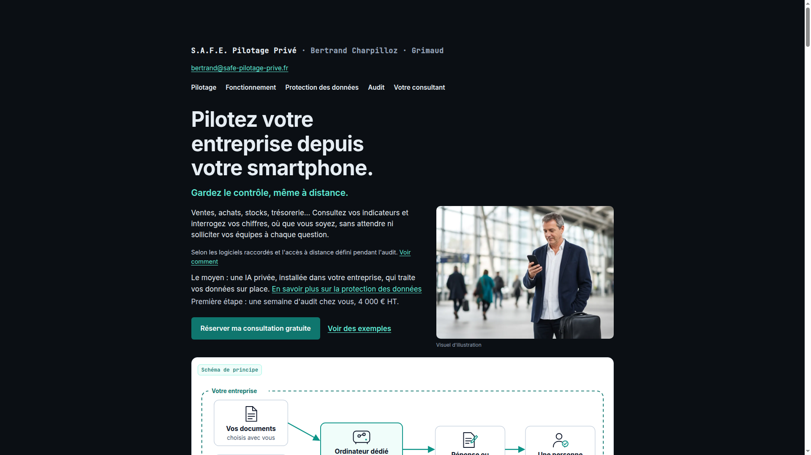
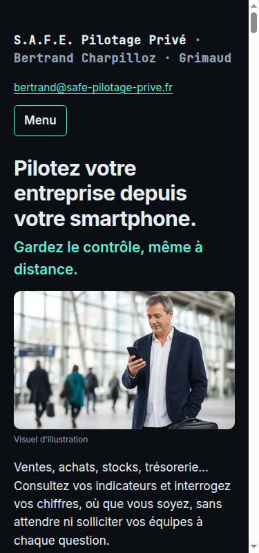

# Landing Business IA V8 - Screenshots

Automated screenshots captured during testing on 2026-11-08.

## Desktop View (1920x1080)

- **File**: `desktop-hero-1920x1080.png`
- **Viewport**: 1920x1080 (Full HD desktop)
- **Shows**: Hero section with navigation, headline, hero image, and primary CTA

## Mobile View (375x667)

- **File**: `mobile-hero-375x667.png`
- **Viewport**: 375x667 (iPhone SE size)
- **Shows**: Mobile-responsive layout with stacked elements

## Visual Verification

These screenshots confirm:
- ✅ White/blue-green color scheme intact
- ✅ Hero image displays correctly
- ✅ Typography hierarchy clear
- ✅ CTAs visible and styled
- ✅ Navigation menu present
- ✅ Mobile-responsive layout adapts correctly
- ✅ No broken assets or layout issues

## Manual Testing Still Required

Screenshots show static visual appearance only. Manual browser testing needed for:
- Interactive elements (menu toggle, CTAs, anchors)
- Responsive breakpoints behavior
- Cross-browser compatibility
- Performance and loading

See TEST_RESULTS.md for complete testing checklist.
